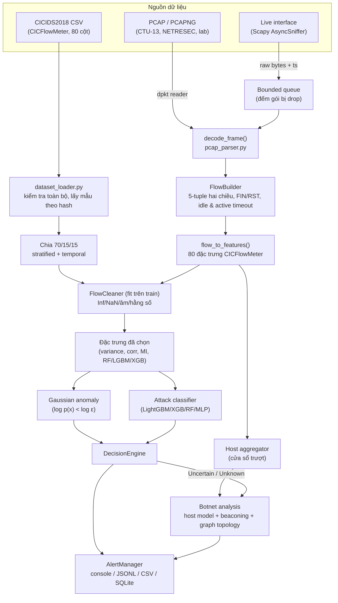
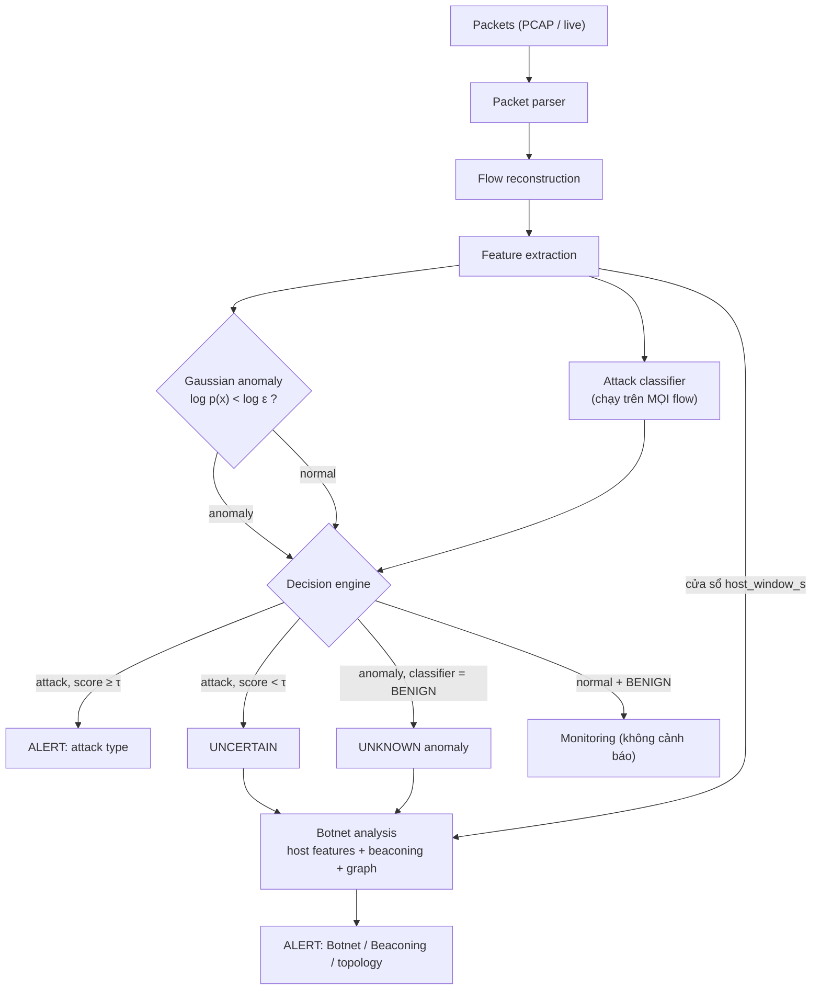

# Kiến trúc hệ thống

## 1. Tổng quan

Hệ thống gồm hai phần dùng chung một lõi xử lý:

* **Phần nghiên cứu offline**: tải và kiểm tra dữ liệu → tiền xử lý → huấn luyện/tuning trên validation → đánh giá độc lập trên test → phân tích botnet trên CTU-13.
* **Phần triển khai**: đọc PCAP hoặc bắt gói trực tiếp → dựng flow → trích đặc trưng → pipeline phát hiện đa tầng → cảnh báo.

Nguyên tắc quan trọng nhất là **feature parity**: chỉ có *một* bộ giải mã gói (`decode_frame`), *một* bộ dựng flow (`FlowBuilder`) và *một* bộ công thức đặc trưng (`flow_to_features`, tái hiện 80 cột CICFlowMeter của CICIDS2018). File PCAP (dpkt) và bắt gói trực tiếp (Scapy) chỉ khác nhau ở *nguồn byte*.

## 2. Pipeline phát hiện đa tầng

Khác với sơ đồ gốc trong đề cương, classifier chạy trên **mọi** flow chứ không chỉ flow bất thường, vì mô hình Gaussian có thể bỏ sót các tấn công có thống kê giống traffic bình thường ("Normal không phải an toàn tuyệt đối"). Chi phí bổ sung nhỏ (vài µs/flow với LightGBM).

## 3. Module và phụ thuộc

| Package | Module | Vai trò | Phụ thuộc |
|---|---|---|---|
| `src/data_processing` | `pcap_parser` | Giải mã Ethernet/VLAN/SLL/IPv4/IPv6/TCP/UDP/ICMP; payload tính từ IP total length | dpkt |
| | `flow_builder` | Flow hai chiều kiểu CICFlowMeter, thống kê Welford, timeout, giới hạn RAM | pcap_parser |
| | `feature_extractor` | 80 đặc trưng CICFlowMeter (tên/thứ tự/đơn vị) | flow_builder |
| | `dataset_loader` | Đọc CICIDS2018 theo chunk, thống kê, trùng lặp, lấy mẫu; đọc CTU-13 binetflow | feature_extractor |
| | `preprocessing` | Cleaner, split, chọn đặc trưng, scaler, xử lý mất cân bằng, lưu artifact | sklearn, imblearn |
| | `host_aggregator` | Đặc trưng mức host (entropy, tỉ lệ lỗi, chu kỳ...) | pandas |
| `src/models` | `random_forest`, `xgboost_model`, `lightgbm_model`, `catboost_model`, `baselines` | Builder + không gian tham số | sklearn/xgboost/lightgbm/catboost |
| | `mlp` | MLP PyTorch + huấn luyện, early stopping, lưu/nạp | torch |
| | `gaussian_detector` | Gaussian đơn biến/đa biến, chọn ε | numpy/scipy |
| `src/graph` | `graph_builder`, `topology_analyzer`, `beaconing_detector` | Đồ thị NetworkX, centralized/P2P, beaconing | networkx |
| `src/detection` | `decision_engine`, `alert_manager`, `detection_pipeline`, `bundle` | Kết hợp module, cảnh báo, gói mô hình triển khai | tất cả ở trên |
| `src/realtime` | `packet_capture`, `realtime_processor`, `monitor` | Scapy capture / PCAP replay, vòng xử lý, đo độ trễ | detection |
| `src/utils` | `config`, `logger`, `metrics`, `visualization` | Dùng chung | — |

## 4. Luồng dữ liệu và artifact

| Bước | Lệnh | Đầu ra |
|---|---|---|
| Tải dữ liệu | `scripts/download_dataset.py cicids2018` | `data/raw/cicids2018/*.csv`, `MANIFEST.json` |
| Tiền xử lý | `scripts/preprocess_dataset.py --stage all` | `reports/metrics/cicids_inspection.json`, `data/interim/cicids2018_sample.parquet`, `data/processed/*_clean.parquet`, `models/preprocessing/*` |
| Huấn luyện | `scripts/train.py --task multiclass|binary` | `models/<model>/<task>/`, `reports/experiments/training_summary_*.json` |
| Anomaly | `scripts/train_anomaly.py` | `models/gaussian/gaussian.joblib`, `reports/metrics/anomaly_results.json` |
| Đánh giá | `scripts/evaluate.py --stage all` | `reports/metrics/model_comparison_*.csv`, hình trong `reports/figures/` |
| CTU-13 | `scripts/process_pcap.py ... --part-dir`, `scripts/botnet_analysis.py` | `data/processed/ctu13_s42_flows/`, `reports/metrics/botnet_*` |
| Đóng gói | `scripts/build_bundle.py` | `models/deployment/bundle.joblib` |
| Realtime | `scripts/run_realtime.py --interface eth0` | `logs/alerts/alerts.{jsonl,csv,db}`, `run_summary.json` |
