# Tiền xử lý dữ liệu (CSE-CIC-IDS2018)

Pipeline: `scripts/preprocess_dataset.py` (các stage `inspect → sample → split → clean → select → imbalance`), dùng các module `src/data_processing/dataset_loader.py` và `src/data_processing/preprocessing.py`. Mọi số liệu dưới đây được sinh bởi chính pipeline này (file nguồn ghi trong ngoặc).

```mermaid
flowchart LR
    A["10 CSV, 16,232,943 dòng"] -->|"đọc theo khối (pyarrow), bỏ 59 header lặp"| B["Thống kê toàn bộ<br/>(NaN, Inf, âm, hằng, trùng)"]
    B --> C["Lấy mẫu trên dòng DUY NHẤT<br/>theo hash (seed 42)"]
    C -->|"1,779,198 dòng"| D["Loại 1,914 vector<br/>xung đột nhãn (3,833 dòng)"]
    D -->|"1,775,365"| E["Chia 70/15/15<br/>stratified theo nhãn chi tiết<br/>+ biến thể temporal"]
    E --> F["FlowCleaner fit trên TRAIN<br/>Inf/NaN/âm/cột hằng"]
    F --> G["Chọn đặc trưng trên TRAIN<br/>variance → MI, RF, LGBM, XGB → corr → k-sweep (VAL)"]
    G --> H["30 đặc trưng"]
    H --> I["Scaling (chỉ MLP, LR, Gaussian)<br/>sign·log1p + StandardScaler fit trên TRAIN"]
```

## 1. Kiểm tra dữ liệu (data inspection)

Duyệt toàn bộ 16,232,943 dòng một lần (đọc theo khối, không cần nạp toàn bộ vào RAM): số dòng/cột, kiểu dữ liệu, NaN, ±Inf, giá trị âm, giá trị 0, min/max/mean/std, cột hằng, phân phối nhãn theo ngày, trùng lặp (băm toàn bộ vector đặc trưng). Bảng kết quả: `docs/DATASET_DOCUMENTATION.md` §1.4 và `reports/metrics/cicids_inspection.json`, `cicids_column_stats_raw.csv`.

Đọc dữ liệu: mọi cột được đọc dưới dạng chuỗi rồi mới ép kiểu, vì các dòng header lặp giữa file làm hỏng việc tự suy kiểu; token không phải số (văn bản, rỗng) → NaN; `Infinity` → +∞. `Timestamp` (định dạng `dd/mm/YYYY HH:MM:SS`) chuyển thành epoch giây, chỉ dùng để chia theo thời gian, **không** là đặc trưng.

Hai lỗi về thời gian được phát hiện và sửa trong quá trình làm (`tests/test_preprocessing_loader.py` kiểm tra giá trị epoch chính xác):

1. *Lỗi của dự án*: pandas 3 phân tích ngày giờ với độ phân giải micro-giây; phép chia `int64 // 10**9` (giả định nano-giây) làm mọi timestamp nhỏ đi 1000 lần. Chỉ ảnh hưởng tới cách chia theo thời gian (đặc trưng, nhãn, cách chia ngẫu nhiên và mọi mô hình không dùng `Timestamp`); đã sửa bằng chuyển đổi đơn vị tường minh, lấy mẫu lại (kết quả trùng khớp từng dòng và nhãn với lần trước) và tạo lại tập chia theo thời gian.
2. *Lỗi của dataset*: CSV dùng đồng hồ 12 giờ không có AM/PM (chỉ có giờ 01–12). Quy ước: 01–07 → +12 h. Sau chuyển đổi, mọi ngày nằm trong 08:28–17:30.

## 2. Lấy mẫu tập làm việc và khử trùng lặp

Lý do: 16.2 triệu dòng × 78 cột float64 ≈ 10 GB, không huấn luyện được trên máy 16 GB RAM / 4 core trong thời gian hợp lý.

Cách làm (`build_cicids_sample`):

1. Với mỗi nhãn chi tiết, đặt tỉ lệ lấy mẫu \(r = \min(1, \text{cap} / n_{\text{unique}})\), với cap = 150,000 cho mỗi nhãn tấn công và 900,000 cho Benign; \(n_{\text{unique}}\) là số vector đặc trưng duy nhất của nhãn đó (đếm ở bước kiểm tra).
2. Một dòng được giữ nếu \(u(\text{hash}(x)) < r\), với \(u\) là hàm băm → [0,1) tất định (seed 42). Mọi bản sao của cùng một flow nhận cùng quyết định, nên lấy mẫu là **đều trên các flow duy nhất** – các flow bị lặp hàng nghìn lần (FTP-BruteForce, SlowHTTPTest) không được ưu tiên.
3. Gộp các bản sao: 3,293,614 dòng được chọn → **1,779,198 dòng duy nhất** (theo đặc trưng + nhãn).

Tỉ lệ lấy mẫu thực tế: Benign 0.0846; DDoS-LOIC-HTTP 0.2607; DDoS-HOIC 0.7543; mọi nhãn còn lại 1.0 (giữ toàn bộ dòng duy nhất). (`data/interim/cicids2018_sample.json`)

## 3. Xử lý nhãn

* Chuẩn hoá tên nhãn gốc (sửa lỗi chính tả `Infilteration`, khoảng trắng, chữ hoa/thường) → 15 nhãn chi tiết (`FINE_LABEL_NORMALISATION`); nhãn lạ → lỗi, không tự tạo nhãn.
* **Nhị phân**: `IsAttack` = 0 (Benign) / 1 (mọi tấn công).
* **Đa lớp**: 7 nhóm `BENIGN, Botnet, BruteForce, DDoS, DoS, Infiltration, WebAttack` (`FAMILY_OF`). Các nhóm chỉ gộp những biến thể cùng bản chất (vd. 3 công cụ DDoS); không gộp mọi tấn công thành một lớp. Lớp `PortScan` không tồn tại trong CICIDS2018 nên không được dùng.
* Mã hoá: chỉ số lớp theo thứ tự trong `models/preprocessing/family_classes.json` (BENIGN = 0); lưu cùng mô hình (`label_mapping.json`, `bundle.json`).

**Vector xung đột nhãn**: 1,914 vector đặc trưng xuất hiện với hơn một nhãn trong tập làm việc (3,833 dòng): Benign | Infiltration 1,894; FTP | SlowHTTPTest 7; FTP | SSH | SlowHTTPTest 5; Web-BruteForce | SQLi 5; FTP | SSH 2; SQLi | XSS 1. Các dòng này bị **loại** (`conflicting_labels_removed.json`) vì (a) không mô hình nào học được (cùng đầu vào, khác nhãn), (b) nếu giữ, cùng một vector sẽ nằm ở cả train và test. Còn 1,775,365 dòng.

## 4. Chia dữ liệu 70 / 15 / 15

| Nhóm | Train | Validation | Test | Tổng |
|---|---|---|---|---|
| BENIGN | 629,006 | 134,788 | 134,787 | 898,581 |
| DDoS | 211,429 | 45,305 | 45,307 | 302,041 |
| DoS | 137,589 | 29,483 | 29,484 | 196,556 |
| Botnet | 101,174 | 21,681 | 21,680 | 144,535 |
| Infiltration | 97,101 | 20,808 | 20,807 | 138,716 |
| BruteForce | 65,857 | 14,112 | 14,112 | 94,081 |
| WebAttack | 599 | 128 | 128 | 855 |
| **Tổng** | **1,242,755** | **266,305** | **266,305** | **1,775,365** |

* **Chính**: chia ngẫu nhiên phân tầng theo *nhãn chi tiết* (15 nhãn – để XSS, SQLi... có mặt ở cả ba tập), seed 42, hai bước (70 / 30 rồi 50 / 50). Kiểm tra: **0** vector đặc trưng dùng chung giữa bất kỳ hai tập nào (`split_config.json`: `row_hash_overlap`).
* **Theo thời gian** (kiểm tra tổng quát hoá): với từng nhãn chi tiết, sắp xếp theo `Timestamp`, 70% sớm nhất → train, 15% tiếp theo → validation, 15% muộn nhất → test. Mô hình phải nhận ra giai đoạn sau của một chiến dịch tấn công chỉ từ giai đoạn đầu; cách chia ngẫu nhiên không kiểm tra được điều này vì các flow liền kề của cùng một phiên rơi vào cả ba tập. Không thể chia theo *ngày* cho bài toán đa lớp vì mỗi loại tấn công chỉ xuất hiện trong 1–2 ngày.
* Test chỉ được đọc trong `scripts/evaluate.py` (và `train_anomaly.py` khi đánh giá cuối), sau khi đã chọn mô hình/ngưỡng trên validation.

## 5. Làm sạch (FlowCleaner – fit trên train)

| Vấn đề | Quyết định | Lý do |
|---|---|---|
| `+Inf` ở cột tốc độ (`Flow Byts/s`, `Flow Pkts/s`, `Fwd Pkts/s`, `Bwd Pkts/s`) | thay bằng **giá trị hữu hạn lớn nhất của train** | Inf sinh ra khi thời lượng flow = 0 nhưng có dữ liệu – "tốc độ cực lớn"; thay bằng trung vị sẽ xoá tín hiệu này |
| `NaN` ở cột tốc độ | thay bằng 0 | NaN = 0 byte / 0 giây: không có lưu lượng |
| `NaN` ở cột khác | trung vị của train | không có trong CICIDS2018; dùng khi PCAP/realtime thiếu cột |
| Thời gian âm (`Flow Duration`, `*IAT*`, `Active*`, `Idle*`) | đặt 0 | lỗi đồng hồ (tới −9.47·10¹¹ µs), không có ý nghĩa vật lý |
| `Init Fwd/Bwd Win Byts = -1` | **giữ** | giá trị quy ước "không có TCP window" (UDP, hoặc không có gói chiều về) – mang thông tin |
| Cột hằng trên train | loại 8 cột: `Bwd PSH Flags`, `Bwd URG Flags`, 6 cột bulk (`Fwd/Bwd Byts/b Avg`, `Pkts/b Avg`, `Blk Rate Avg`) | phương sai 0 |
| Cột định danh `Flow ID`, `Src IP`, `Src Port`, `Dst IP`, `Timestamp` | không dùng làm đặc trưng | định danh môi trường mô phỏng, gây leakage; chỉ có ở 1/10 file |
| Outlier | **không loại** | giá trị cực đoan (tốc độ gói rất cao, flow rất dài) chính là dấu hiệu DoS/DDoS/Slowloris – xem phân tích ngoại lai trong EDA §12. Thay vào đó dùng mô hình cây (bất biến với biến đổi đơn điệu) và biến đổi `sign·log1p` cho mô hình nhạy với thang đo |
| Trùng lặp | khử ở bước lấy mẫu (§2) | tránh thổi phồng lớp lặp và rò rỉ train ↔ test |

Sau làm sạch còn **70 đặc trưng số**, tất cả hữu hạn. Cleaner được lưu (`models/preprocessing/cleaner_split.joblib`) và đưa vào bundle triển khai, nên PCAP/realtime được làm sạch giống hệt.

## 6. Feature engineering

Các đặc trưng flow đã là đặc trưng kỹ thuật của CICFlowMeter (thống kê độ dài gói, IAT, cờ TCP, tốc độ, header...). Dự án tái hiện chúng từ gói tin trong `feature_extractor.py` (cùng tên, thứ tự, đơn vị) và **bổ sung đặc trưng mức host** cho bài toán botnet (`host_aggregator.py`: số IP/port đích duy nhất, tỉ lệ kết nối thất bại, SYN không ACK, entropy port/IP đích, trung bình/độ lệch khoảng cách kết nối, điểm chu kỳ, kết nối lặp...) và **đặc trưng đồ thị** (degree, PageRank, betweenness, clustering). Công thức: `docs/MODEL_DOCUMENTATION.md` §6.

Các đặc trưng được ưu tiên trong đề cương đều có trong schema (đã kiểm tra): Flow Duration, Tot Fwd/Bwd Pkts, TotLen Fwd/Bwd Pkts, Flow Byts/s, Flow Pkts/s, Flow/Fwd/Bwd IAT Mean, Flow IAT Std, Pkt Len Mean/Std, SYN/ACK/FIN/RST Flag Cnt, Dst Port, Protocol.

## 7. Chọn đặc trưng (chỉ trên train; k chọn bằng validation)

Thực hiện trên mẫu con phân tầng 300,000 dòng của train, mục tiêu đa lớp:

1. **Variance threshold** (ngưỡng 0): không loại thêm cột nào (cột hằng đã loại ở bước làm sạch).
2. Bốn bảng xếp hạng: **mutual information**, **Random Forest importance** (Gini), **LightGBM gain**, **XGBoost gain**; hạng trung bình → `reports/metrics/feature_ranking.csv`. Top 5: `Dst Port`, `Fwd Header Len`, `Fwd Pkt Len Max`, `Init Fwd Win Byts`, `Bwd Header Len`.
3. **Lọc tương quan** (|Pearson r| > 0.98): duyệt theo hạng, loại đặc trưng tương quan cao với một đặc trưng hạng cao hơn đã giữ → loại 20 đặc trưng, ví dụ `Tot Fwd Pkts` ≈ `Fwd Header Len` (r = 1.0, vì header TCP gần như cố định 20/32 byte nên tổng header tỉ lệ với số gói), `Flow Duration` ≈ `Fwd IAT Tot` (0.996), `Fwd Seg Size Avg` ≡ `Fwd Pkt Len Mean`, 4 cột `Subflow *` ≡ tổng tương ứng. Đáng chú ý: `SYN Flag Cnt` trùng hoàn toàn với `Fwd PSH Flags` và `CWE Flag Count` với `Fwd URG Flags` (r = 1.0) – dấu hiệu lỗi ánh xạ cột trong bản CSV CICFlowMeter đã công bố.
4. **k-sweep**: LightGBM (300 cây) với k đặc trưng đầu tiên, đánh giá macro-F1 trên validation:

| k | 5 | 10 | 15 | 20 | 25 | **30** | 40 | 50 |
|---|---|---|---|---|---|---|---|---|
| Val macro-F1 | 0.8497 | 0.8743 | 0.8899 | 0.8905 | 0.8905 | **0.8923** | 0.8943 | 0.8935 |
| Val FPR | 0.0092 | 0.0168 | 0.0186 | 0.0191 | 0.0196 | 0.0205 | 0.0200 | 0.0203 |

Quy tắc: chọn k nhỏ nhất có macro-F1 ≥ (tốt nhất − 0.002) → **k = 30** (`models/preprocessing/selected_features.json`):

`Dst Port, Fwd Header Len, Fwd Pkt Len Max, Init Fwd Win Byts, Bwd Header Len, Fwd Seg Size Min, Fwd Pkt Len Mean, Pkt Len Mean, Fwd IAT Tot, Bwd Pkts/s, Bwd Pkt Len Std, Flow IAT Max, Pkt Len Max, RST Flag Cnt, Flow IAT Std, Fwd IAT Mean, Bwd Pkt Len Mean, Flow IAT Min, Pkt Len Std, Bwd Pkt Len Max, Fwd Pkt Len Std, Init Bwd Win Byts, Fwd Pkts/s, Flow Byts/s, PSH Flag Cnt, Fwd IAT Std, Idle Max, ACK Flag Cnt, Flow Pkts/s, Bwd IAT Tot`

Giảm từ 70 xuống 30 đặc trưng (−57%) với mức giảm macro-F1 0.002 so với k = 40.

**Sự cố được phát hiện và sửa**: lần chạy đầu, k-sweep cho kết quả vô lý (macro-F1 *giảm* từ 0.63 xuống 0.43 khi thêm đặc trưng, FPR tới 52%). Chẩn đoán: LightGBM đa lớp **phân kỳ số học** – log-loss trên *train* giảm tới 0.185 ở vòng 27 rồi tăng lên 8.29 ở vòng 300, trong khi Random Forest trên cùng dữ liệu đạt macro-F1 train 0.9996. Nguyên nhân: các lớp gần như tách rời tạo lá có hessian ≈ 0 → giá trị lá cực lớn. Sửa bằng `min_sum_hessian_in_leaf = 1` (mặc định 1e-3), val macro-F1 0.62 → 0.90; áp dụng cho mọi nơi dùng LightGBM và chạy lại toàn bộ bước chọn đặc trưng (`reports/experiments/lightgbm_divergence.json`).

### 7.1 Kiểm tra data leakage

| Nguồn nguy cơ | Đánh giá | Quyết định |
|---|---|---|
| `Flow ID`, `Src IP`, `Dst IP`, `Src Port` | định danh máy trong môi trường mô phỏng; nhãn được gán theo IP → mô hình sẽ học "IP nào là kẻ tấn công" | loại |
| `Timestamp` | nhãn được gán theo khung giờ → mô hình học "giờ nào có tấn công" | loại khỏi đặc trưng, chỉ dùng để chia theo thời gian |
| Trùng lặp giữa train/test | 26% dữ liệu gốc là bản sao | khử trùng lặp trước khi chia; kiểm tra 0 vector chung |
| Vector xung đột nhãn | cùng vector ở nhiều tập | loại (§3) |
| Scaler/cleaner/selection fit trên toàn bộ dữ liệu | rò thống kê validation/test vào train | mọi thứ fit trên train; k chọn trên validation; test không tham gia |
| SMOTE trước khi chia | mẫu tổng hợp từ điểm test | chỉ resample tập train (và chỉ trong thí nghiệm so sánh) |
| `Dst Port` | dịch vụ đích là thông tin hợp lệ, nhưng trong CICIDS2018 mỗi tấn công nhắm một cổng cố định (21 FTP, 22 SSH, 80 web) → có thể là "đường tắt" | **giữ**, nhưng đo ảnh hưởng bằng ablation (EXPERIMENT_RESULTS §ablation) |
| `Init Fwd/Bwd Win Byts` | TCP window đầu phụ thuộc hệ điều hành máy tấn công trong testbed → có thể là đặc trưng môi trường | **giữ**, đo bằng ablation |

Kiểm tra đường tắt bằng mô hình một đặc trưng (cây độ sâu 4, train → validation; `single_feature_macro_f1.csv`): đặc trưng mạnh nhất khi dùng một mình là `Bwd Pkt Len Max` (macro-F1 0.573), `Pkt Len Max` (0.546), `TotLen Fwd Pkts` (0.546); `Dst Port` riêng lẻ đạt 0.508. Không đặc trưng đơn lẻ nào gần phân loại hoàn hảo – không có dấu hiệu một cột "mã hoá" nhãn.

## 8. Scaling

* Mô hình cây (RF, XGBoost, LightGBM, CatBoost, Decision Tree): **không scale** – chỉ so sánh ngưỡng, bất biến với biến đổi đơn điệu.
* MLP, Logistic Regression, Gaussian: `LogScaler` = \(\mathrm{sign}(x)\log(1+|x|)\) rồi một scaler, fit **chỉ trên train** (Gaussian: chỉ trên Benign của train). Biến đổi log nén các đặc trưng trải 9–10 bậc độ lớn (`Flow Byts/s` tới ~10⁹) mà không bỏ flow cực đoan.
* So sánh Standard / Robust / MinMax, có/không log, cho MLP: `reports/experiments/scaler_comparison.csv` (kết quả và lựa chọn: EXPERIMENT_RESULTS.md).

## 9. Mất cân bằng lớp

Tỉ lệ lớp lớn nhất/nhỏ nhất: toàn bộ dữ liệu 13,484,708 Benign so với 928 WebAttack (≈ 14,500 : 1); tập làm việc 898,581 : 855 (≈ 1,050 : 1).

So sánh trên validation (LightGBM 300 cây, mẫu train 300k, 30 đặc trưng; resampling **chỉ trên train**, validation/test không bao giờ bị resample) – `reports/metrics/imbalance_comparison.csv`:

| Chiến lược | Dòng train | Precision macro | Recall macro | Macro-F1 | Weighted-F1 | FPR (Benign → tấn công) | Recall Infiltration | Recall WebAttack |
|---|---|---|---|---|---|---|---|---|
| Không xử lý | 300,499 | 0.906 | 0.900 | **0.892** | **0.935** | **0.0205** | 0.400 | 0.922 |
| class_weight = balanced | 300,499 | 0.825 | 0.935 | 0.856 | 0.902 | 0.1856 | 0.775 | 0.953 |
| Random undersampling | 199,696 | 0.855 | 0.925 | 0.881 | 0.926 | 0.0949 | 0.624 | 0.945 |
| SMOTE (lớp nhỏ → 20,000) | 323,981 | 0.892 | 0.906 | 0.884 | 0.935 | 0.0205 | 0.399 | 0.961 |
| SMOTE + undersampling | 223,178 | 0.843 | 0.928 | 0.871 | 0.926 | 0.0952 | 0.625 | 0.969 |

Nhận xét:

* Mọi chiến lược đều cho recall ≥ 0.9995 với Botnet, BruteForce, DDoS, DoS – mất cân bằng không phải vấn đề với các lớp này.
* Khó khăn thực sự là **Infiltration**: các phương pháp tăng trọng số lớp hiếm nâng recall Infiltration (0.40 → 0.78) nhưng đẩy FPR từ 2% lên 9.5–18.6% – tức là Infiltration và Benign chồng lấn mạnh trong không gian đặc trưng (khớp với 1,894 vector trùng hoàn toàn đã phát hiện); tăng trọng số chỉ dời ranh giới quyết định chứ không tách được hai lớp.
* SMOTE chỉ cải thiện nhẹ WebAttack (0.922 → 0.961, 128 mẫu validation) và giảm macro-F1 do precision giảm.
* Quyết định: **không resample** làm mặc định (macro-F1 cao nhất, FPR thấp nhất – hai tiêu chí ưu tiên của IDS); `class_weight` vẫn nằm trong không gian tuning của RF/LightGBM/CatBoost và trọng số lớp (căn bậc hai) được dùng cho MLP, để tuning trên validation quyết định. Đánh đổi FPR ↔ recall Infiltration được báo cáo rõ trong EXPERIMENT_RESULTS.

## 10. Tái lập

Seed 42 cho lấy mẫu, chia, mô hình; `config/config.yaml` chứa mọi tham số; artifact: `models/preprocessing/{cleaner_split.joblib, cleaner_temporal.joblib, selected_features.json, family_classes.json}`; cấu hình chia: `reports/metrics/split_config.json`.
